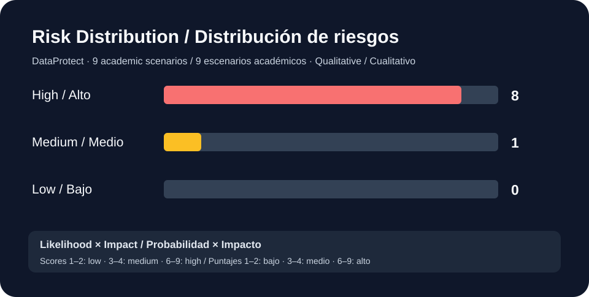

# DataProtect — Cybersecurity Risk Assessment
Evaluación de riesgos de ciberseguridad · ESI School of Management, 2026

[Cybersecurity / Ciberseguridad](../README.md) · [English](#english) · [Español](#español)

## English

### Background
DataProtect is a fictional cybersecurity consultancy. Its internal review identified weak or reused passwords, missing MFA for remote access, outdated software, unregistered visitors and gaps in incident preparation.

### What I did
I built an Excel risk matrix using the findings from the case. For each of **nine scenarios**, I documented the asset, threat, vulnerability, likelihood, impact and proposed mitigation. A second sheet explains the ratings and sets out suggested responsibilities, deadlines and ways to check each action. A third sheet records the criteria and sources.

The ratings use a **3 × 3 likelihood–impact scale**. Eight scenarios were rated high and one medium.

### Files
- [Risk register — bilingual CSV](risk-register-bilingual.csv): a condensed version of the nine scenarios.
- The chart above shows the distribution of risk levels.
- The original three-sheet Excel workbook contains the complete assessment and formulas. It still needs to be added to this repository.

The ratings are qualitative estimates based on the fictional case.

## Español

### Contexto
DataProtect es una consultora ficticia de ciberseguridad. Su revisión interna identificó contraseñas débiles o repetidas, ausencia de MFA para acceso remoto, software desactualizado, visitantes sin registro y deficiencias en la preparación ante incidentes.

### Qué hice
Elaboré una matriz de riesgos en Excel a partir de los hallazgos del caso. Para cada uno de **nueve escenarios**, registré el activo, la amenaza, la vulnerabilidad, la probabilidad, el impacto y una medida de mitigación propuesta. Una segunda hoja explica las valoraciones y plantea responsables, plazos y formas de verificar las acciones. La tercera contiene los criterios y las fuentes.

Utilicé una **escala de probabilidad e impacto de 3 × 3**. Ocho riesgos quedaron clasificados como altos y uno como medio.

### Archivos
- [Registro de riesgos — CSV bilingüe](risk-register-bilingual.csv): versión resumida de los nueve escenarios.
- El gráfico anterior muestra la distribución por nivel de riesgo.
- El archivo original de Excel, de tres hojas, contiene las valoraciones y fórmulas completas. Todavía falta añadirlo al repositorio.

Las valoraciones son estimaciones cualitativas basadas en el caso ficticio.
